# 1. Problem and approach

Each trip has a noisy 1 Hz GPS track and a local directed road network (nodes and arcs). The task is to match every GPS observation to the arc the vehicle was actually on and to reconstruct a continuous route.

**Final result on the 10 student-test trips: 92.38% of GPS observations matched to the correct road**, compared with 54.49% for simply picking the nearest road.

The pipeline has four stages:

1. **Candidate generation.** For every GPS point, keep up to 8 arcs within 50 m.
2. **Candidate classification.** A LightGBM model scores P(candidate is the reference arc) from 23 features.
3. **Sequential decoding.** An HMM uses the classifier probabilities as emissions and road-network driving distances as transitions. Viterbi decoding picks the most likely connected route.
4. **Deployment.** A FastAPI service on Laptop 1 runs the full pipeline for a requested trip and scores it server-side. A browser UI on Laptop 2 displays the result.

**Team PT-059**

| # | SRN | Name | GitHub | Stage owned | Models trained |
|---|---|---|---|---|---|
| 1 | PES1UG24AM908 | Sonu Akash Soundararajan | SonuAkash-collab | Data loading, cleaning, EDA, candidate generation, feature engineering | Logistic Regression, Decision Tree |
| 2 | PES1UG24AM909 | Ayush P Mankal | SpiderByte07 | Bayesian optimisation, HMM/Viterbi decoder, decoder evaluation, exported model | Random Forest, KNN |
| 3 | PES1UG25AM810 | Purushothama K C | Purushothama449 | Shared trainer, grouped cross-validation, metrics, model comparison | LightGBM, HistGradientBoosting |
| 4 | PES1UG25AM811 | Sahana Kadappa | sahanagolabanvi34-debug | FastAPI backend, UI, deployment, run scripts, report | Gaussian Naive Bayes, MLP |

# 2. Dataset understanding and EDA

Partitions used: **train (80 trips)** and **student_test (10 trips)**. The evaluator partition was not used for any training, tuning or model selection. Code: `scripts/01_eda.py`, `scripts/02_build_features.py`; outputs in `results/eda/` and `results/candidates/`.

## 2.1 What the files contain

| File | Content (verified) | Notes |
|---|---|---|
| `.track` | lon, lat, t (s) | 1 Hz nominal; 96.5% (train) and 98.6% (student test) of steps are exactly 1 s |
| `.nodes` | lon, lat; row index = node id | median 9,608 nodes per training trip |
| `.arcs` | from_node, to_node; row index = arc id | directed; 92% of arcs have a reverse twin (two-way streets) |
| `.route` | ordered arc ids | consecutive route arcs connected in ≥ 98.1% of steps; no invalid ids |

A row in `.track` does not correspond to a row in `.route`: a trip has about 1,500 GPS points but only about 280 route arcs. We therefore built per-observation labels ourselves (section 2.3).

## 2.2 Preprocessing

* **Cleaning** (`pathsnap/io.py`, `clean_track`): drop non-finite or out-of-range coordinates, sort by time, drop duplicate timestamps. We found 0 invalid rows, 0 duplicate timestamps and 0 unsorted trips. The checks stay in the pipeline because unseen trips may differ.
* **Projection** (`pathsnap/geo.py`): one degree of latitude is about 111 km, but one degree of longitude is 111 km × cos(latitude), so Euclidean distance in degrees is wrong. The trips are spread over several continents (25 UTM zones in train, 9 in student test), so each trip is projected to its own UTM zone, chosen from its median GPS position. Projected step lengths differ from haversine distances by at most 0.55%.
* **Road network** (`pathsnap/network.py`): each arc is a straight segment between its nodes. A KD-tree over points sampled every 5 m along all arcs gives fast "arcs within R metres" queries; a bounded Dijkstra gives directed driving distances.

## 2.3 Patterns observed

| | Train | Student test |
|---|---|---|
| Trips / observations | 80 / 208,417 | 10 / 19,160 |
| Observations per trip (min / median / max) | 361 / 1,529 / 19,313 | 262 / 1,420 / 3,958 |
| Missing or invalid GPS rows | 0 | 0 |
| Trips with a gap > 60 s | 22 | 1 |
| Trips with a gap > 1 h | 2 | 0 |
| GPS → reference arc distance (median / 95th / 99th pct) | 4.9 / 17.8 / 37.2 m | 5.3 / 16.8 / 27.2 m |
| Networks with more than one weakly connected component | 79 / 80 | 10 / 10 |
| Observations that could be labelled | 89.2% | 99.9% |

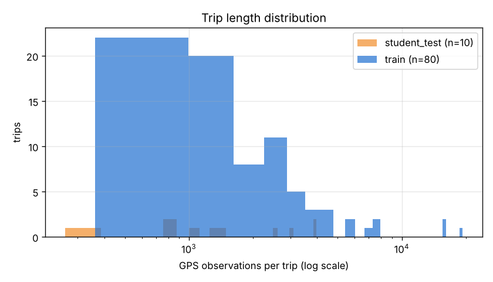{width=48%} 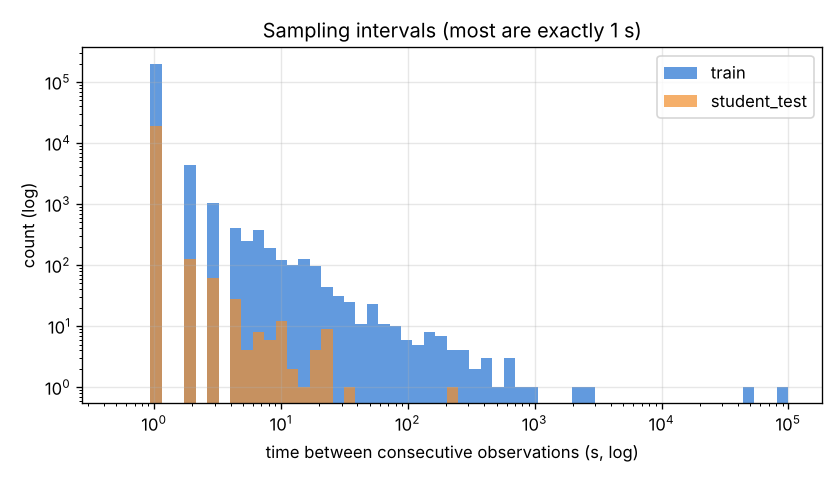{width=48%}

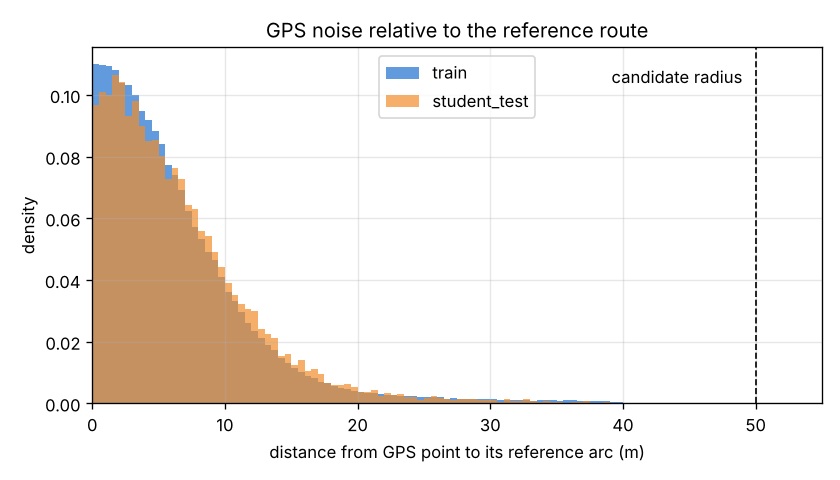{width=48%} 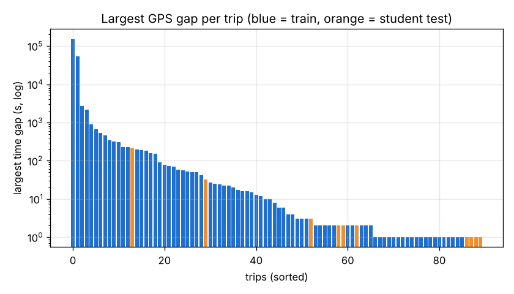{width=48%}

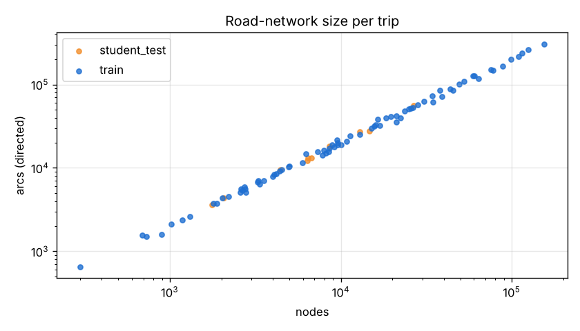{width=48%} 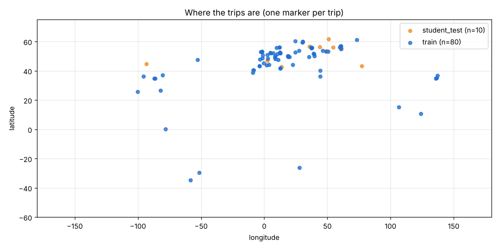{width=48%}

**Labels.** Each observation is assigned to a route position with a monotone dynamic programme: positions never go backwards along the route, and the sum of point-to-arc distances is minimised (`pathsnap/labels.py`). Only route arcs within 50 m are considered. Keeping the travel order matters where a route uses both directions of a street.

**Reference-route limitations.** In a few training trips the reference route covers only part of the GPS track (trip 00000054: 170 km of GPS against a 31 km route). Those observations are left unlabelled and excluded from training and scoring. We treat `.route` as reference information, not verified ground truth; section 5.2 shows trips where its direction contradicts the GPS heading.

Interactive Folium maps (GPS points, road network, reference route, layer control and legend) are generated by `scripts/03_eda_maps.py`.

## 2.4 Candidates and features

Candidates: arcs within **50 m**, at most **k = 8** per observation, with a 150 m / k = 4 fallback when nothing is within 50 m. The radius follows from the noise distribution above.

| | Train | Student test |
|---|---|---|
| Candidate rows | 1,156,038 | 113,648 |
| Candidates per observation | 5.6 | 5.9 |
| Positive rate | 15.8% | 16.8% |
| Candidate miss rate (reference arc not among candidates) | 0.67% | 0.28% |
| Nearest-arc baseline, top-1 | 56.0% | 54.5% |

The nearest arc is often the opposite direction of a two-way street or a side street at a junction, which is why the features below are needed.

| Group | Features | Why |
|---|---|---|
| Geometry (7) | `dist`, `dist_rank`, `dist_minus_min`, `dist_ratio`, `n_cands`, `t`, `outside` | closeness, relative to the other candidates of the same point |
| Heading (4) | `head_diff`, `head_diff_wide` (window i±3), `cos_head_wide`, `head_rank` | separates the two directions of a street and crossing streets |
| Context (3) | `win_dist_mean`, `win_dist_max`, `win_rank` (points i±2 to the same arc) | one noisy point can sit near a side street; its neighbours usually do not |
| Kinematics (4) | `speed`, `dt_prev`, `dt_next`, `move_wide` | heading is unreliable when the vehicle is stopped |
| Topology (5) | `arc_length`, `out_deg_end`, `in_deg_start`, `has_reverse`, `expanded` | junction density and two-way streets |

**Feature selection** (`scripts/10_feature_analysis.py`, training trips only, 3-fold group CV). We removed one feature group at a time and retrained LightGBM:

| Setting | Features | CV top-1 | Change |
|---|---|---|---|
| All features | 23 | 0.8922 | |
| Without heading | 19 | 0.5776 | **−31.5 pts** |
| Without geometry | 16 | 0.8517 | −4.1 pts |
| Without context | 20 | 0.8841 | −0.8 pts |
| Without kinematics | 19 | 0.8905 | −0.2 pts |
| Without topology | 18 | 0.8917 | −0.05 pts |
| Distance features only | 4 | 0.5600 | −33.2 pts |

Every group lowers accuracy when removed, so all 23 features were kept. The top 8 features carry 91% of the LightGBM gain: `dist_minus_min` (29.2%), `head_diff_wide` (25.2%), `win_rank` (10.9%), `dist_ratio` (10.3%), `cos_head_wide` (5.6%), `move_wide` (4.9%), `arc_length` (3.1%) and `outside` (2.4%).

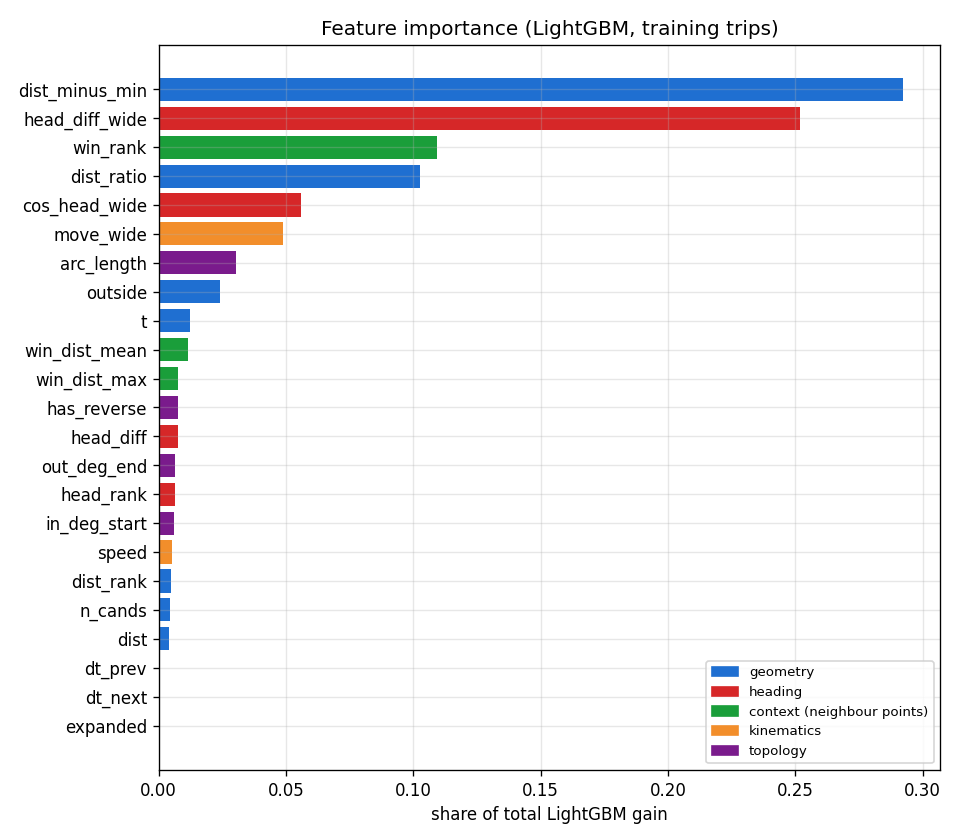{width=48%} 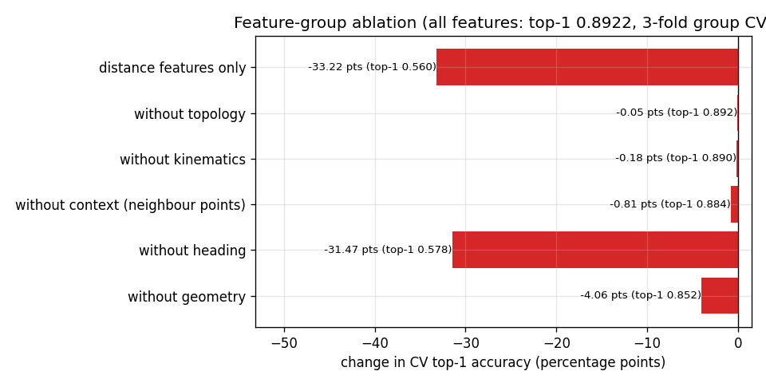{width=48%}

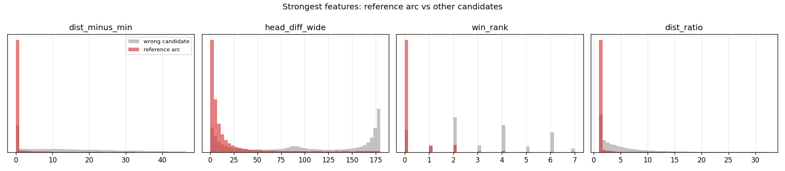{width=95%}

# 3. Model experimentation and comparison

**Setup** (`scripts/04_train_compare.py`, `pathsnap/models.py`). Binary classification per (observation, candidate). Models are fitted on labelled observations of the 80 training trips, keeping every 3rd observation (349,798 rows), because consecutive 1 Hz observations are near-duplicates. Validation is **5-fold GroupKFold by trip**: a trip never appears in both training and validation, since a random split would leak near-identical points. Each model is then refitted on all training rows and scored once on all 113,648 student-test rows. Random seed 42; every model uses the same 23 ordered features and the same splits.

**Primary metric: observation-level top-1 accuracy**: for each GPS point, is the highest-scoring candidate the reference arc? This is what the final output is judged on. We also report candidate-level macro F1 (threshold 0.5) and **log loss**, because the HMM uses the probabilities as emissions.

Each teammate trained their two models on their own laptop with the same code, data and splits; the rows are committed in `results/team/<name>/results.csv`.

## 3.1 Overall comparison

| Model (trained by) | Algorithm family | Key configuration | CV macro F1 (mean ± std) | Top-1 accuracy (student test) | Route continuity | Student-test macro F1 | Log loss (student test) | Inference time (ms / 1,000 obs) |
|---|---|---|---|---|---|---|---|---|
| **LightGBM** (Purushotham) | Boosting | 600 rounds, lr 0.05, 63 leaves, early stopping | 0.9349 ± 0.0097 | **0.9042** | 0.9367 | **0.9400** | **0.0849** | 112.3 |
| Random Forest (Ayush) | Bagging ensemble | 150 trees, depth 18, min leaf 5 | 0.9352 ± 0.0093 | 0.8942 | 0.9289 | 0.9348 | 0.0879 | 15.0 |
| HistGradientBoosting (Purushotham) | Boosting | lr 0.1, ≤ 300 iterations, early stopping | 0.9331 ± 0.0102 | 0.8957 | 0.9241 | 0.9341 | 0.0914 | 8.4 |
| MLP (Sahana) | Neural network | (64, 32) ReLU, Adam, early stopping | 0.9308 ± 0.0099 | 0.8839 | 0.9330 | 0.9280 | 0.0962 | 6.5 |
| Decision Tree (Sonu) | Tree | depth 12, min leaf 50 | 0.9300 ± 0.0111 | 0.8932 | 0.9255 | 0.9317 | 0.1085 | 0.8 |
| Logistic Regression (Sonu) | Linear | L2, C = 1, standardised | 0.9282 ± 0.0102 | 0.8833 | 0.9357 | 0.9254 | 0.1151 | 1.0 |
| KNN (Ayush) | Instance-based | k = 25, distance-weighted, ≤ 150k rows | 0.9281 ± 0.0090 | 0.8808 | 0.9181 | 0.9251 | 0.1502 | 626.9 |
| Gaussian NB (Sahana) | Probabilistic | var_smoothing 1e-9 | 0.9056 ± 0.0119 | 0.8752 | 0.9053 | 0.8963 | 0.5530 | 6.1 |

Top-1 accuracy is observation-level. Route continuity = share of consecutive distinct predicted arcs that are connected within 3 arcs (classifier-only predictions, student test). Inference time was measured on each owner's laptop, so it compares speed only roughly across models. 5-fold CV top-1: LightGBM 0.8945, Random Forest 0.8938, HistGradientBoosting 0.8919, MLP 0.8893, Decision Tree 0.8885, Logistic Regression 0.8872, KNN 0.8842, Gaussian NB 0.8776. Source: `results/models/comparison.csv`.

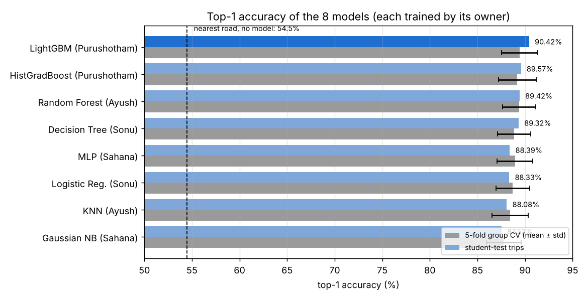{width=85%}

All eight models beat the nearest-arc baseline (54.5%) by more than 32 points, so most of the gain comes from the features. The models land within 3 points of each other.

**Selection: LightGBM.** It is best on CV top-1, student-test top-1, student-test macro F1 and log loss. Its fold-to-fold spread (± 0.019 top-1) matches every other model's; the spread comes from which trips land in a fold (fold 2 is hardest for every model), not from instability. Its low log loss matters because the HMM consumes the probabilities, and inference takes about 0.1 s per 1,000 observations. Random Forest is nearly as accurate in CV but less well calibrated and slower to train; KNN is too slow at inference for the API.

The plots below come from one full 8-model run on Sonu's laptop with the same code. Its numbers agree with the table to within 0.3 points.

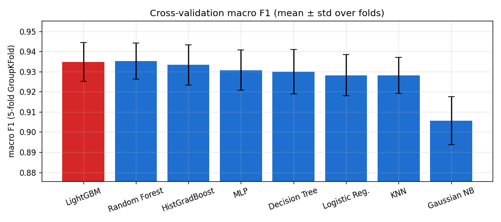{width=49%} 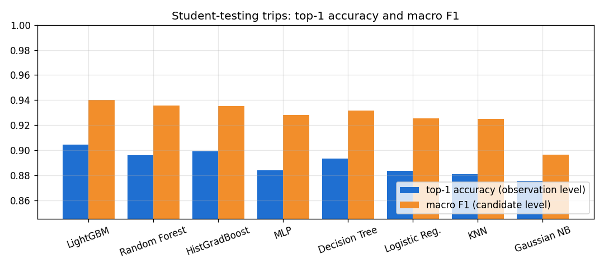{width=49%}

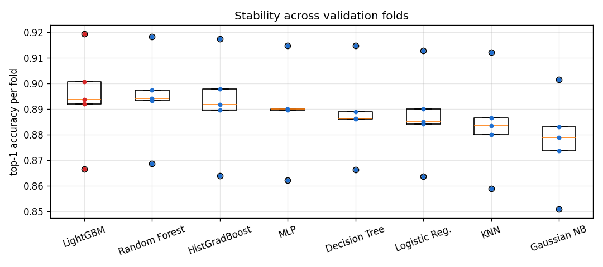{width=49%} 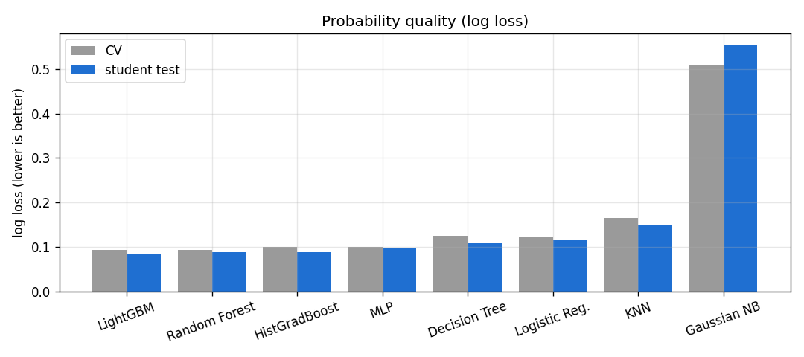{width=49%}

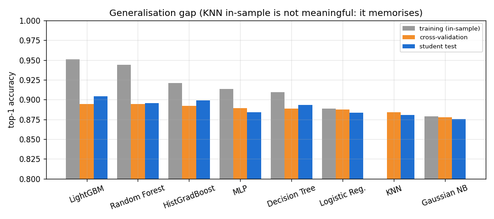{width=49%} 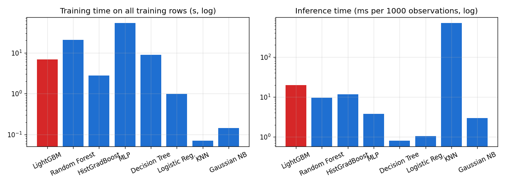{width=49%}

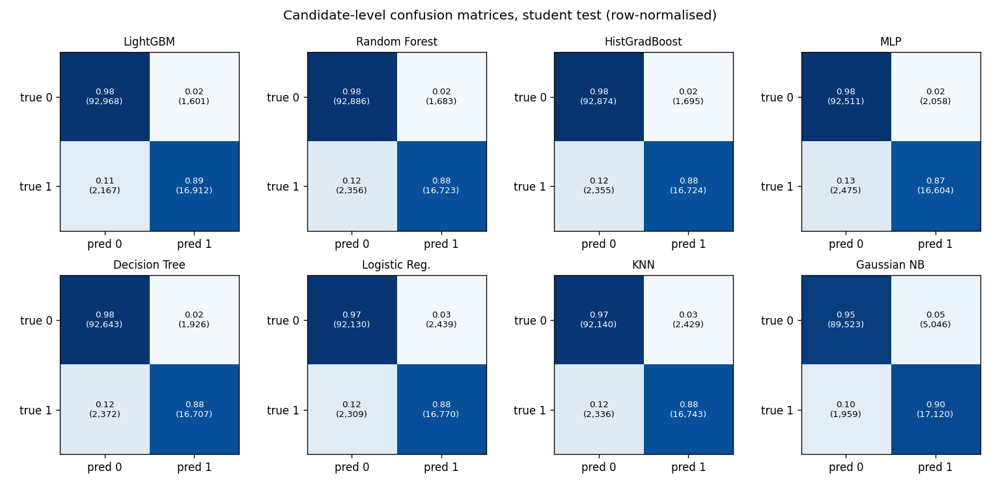{width=90%}

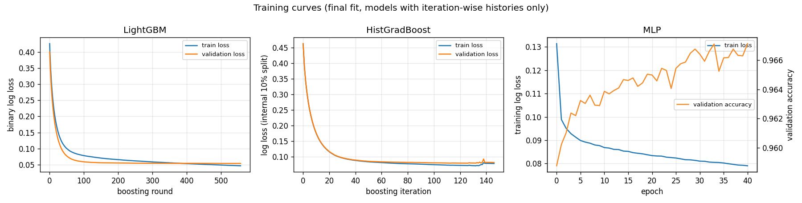{width=95%}

Training curves exist only for models with iteration-wise histories (LightGBM, HistGradientBoosting, MLP); the others are fitted in one pass.

## 3.2 Per-model analysis

### Model 1: Logistic Regression (linear), trained by Sonu
**A. Why.** A linear baseline: if the classes are close to linearly separable in our features (small distance, small heading difference), it should already do well. *Strengths:* fast, stable, interpretable coefficients. *Limitation:* cannot model interactions such as "heading only matters when the vehicle moves".
**B. Configuration.** C = 1.0 (L2), lbfgs, max_iter 500, standardised features. Loss: L2-regularised binary cross-entropy.
**C. Results.** Student-test top-1 0.8833, macro F1 0.9254, log loss 0.1151. In-sample top-1 0.8885 against CV 0.8872: almost no gap, so the model is slightly **underfitting**. Its smooth decisions give the highest route continuity of the classifier-only models (0.9357).

### Model 2: Decision Tree, trained by Sonu
**A. Why.** Learns threshold rules such as "if `dist_rank` = 0 and `head_diff` < 30°", which capture feature interactions. *Limitation:* high variance and coarse probabilities (leaf frequencies).
**B. Configuration.** max_depth 12, min_samples_leaf 50, Gini impurity.
**C. Results.** Student-test top-1 0.8932, macro F1 0.9317, log loss 0.1085. In-sample 0.9096 against CV 0.8885: a **mild overfitting** gap of 2.1 points, held down by the depth and leaf limits.

### Model 3: LightGBM (selected), trained by Purushotham
**A. Why.** Gradient-boosted trees with leaf-wise growth, row/column subsampling and L2 regularisation. *Strengths:* best accuracy and calibration here, fast. *Limitation:* leaf-wise trees can overfit, so they need `min_child_samples` and early stopping.
**B. Configuration.** Up to 600 rounds, lr 0.05, 63 leaves, min_child_samples 40, subsample 0.8, colsample 0.8, λ = 1. Early stopping on 10% of the *training trips* (best iteration 508). Loss: binary log loss.
**C. Results.** Student-test top-1 **0.9042**, macro F1 **0.9400**, log loss **0.0849**. In-sample 0.9510 against CV 0.8945: some memorisation of training trips. The validation loss flattens while the training loss keeps falling, the start of overfitting; early stopping halts it there, and the student-test score (above CV) shows it still generalises.

### Model 4: HistGradientBoosting, trained by Purushotham
**A. Why.** Boosting with histogram binning: each tree fixes the errors of the previous ones. *Limitation:* more hyperparameters; can overfit without early stopping.
**B. Configuration.** lr 0.1, ≤ 300 iterations, 31 leaves, early stopping on an internal 10% split. Loss: binary log loss.
**C. Results.** Student-test top-1 0.8957, macro F1 0.9341, log loss 0.0914. In-sample 0.9170 against CV 0.8919, a small gap; train and validation curves stay close until early stopping.

### Model 5: Random Forest (bagging ensemble), trained by Ayush
**A. Why.** Averages many decorrelated trees, keeping the interactions a tree captures while reducing its variance. *Limitation:* a large model, slower to train and to score.
**B. Configuration.** 150 trees, max_depth 18, min_samples_leaf 5, max_features √d, Gini.
**C. Results.** Student-test top-1 0.8942, macro F1 0.9348, log loss 0.0879. In-sample 0.9441 against CV 0.8938: the deep trees memorise training trips (**overfitting** in-sample), but bagging keeps CV and student-test accuracy high.

### Model 6: KNN (instance-based), trained by Ayush
**A. Why.** Candidates with similar distance and heading patterns should share a label. *Limitation:* stores and searches the training set; sensitive to scaling and irrelevant features.
**B. Configuration.** k = 25, distance-weighted, Euclidean on standardised features, trained on a 150k-row subsample for memory and time. No explicit loss.
**C. Results.** Student-test top-1 0.8808, macro F1 0.9251, log loss 0.1502. Inference took about 627 ms per 1,000 observations, by far the slowest, which rules it out for the API. In-sample accuracy is not meaningful for KNN, which memorises its training rows; CV (0.8842) and student test (0.8808) are close, so it does not overfit across trips.

### Model 7: Gaussian Naive Bayes (probabilistic), trained by Sahana
**A. Why.** A generative baseline with cheap probabilities. *Limitation:* assumes independent Gaussian features, while ours are strongly correlated (`dist`, `win_dist_mean`, `dist_rank`) and skewed.
**B. Configuration.** var_smoothing 1e-9; maximum-likelihood class-conditional Gaussians.
**C. Results.** Student-test top-1 0.8752, macro F1 0.8963, log loss **0.5530**, by far the worst: counting correlated evidence twice makes it over-confident. In-sample 0.8786 ≈ CV 0.8776: **underfitting** from model bias, not variance.

### Model 8: MLP (neural network), trained by Sahana
**A. Why.** Learns non-linear combinations of the standardised features. *Limitation:* needs scaling and tuning, and tabular features give it little advantage over trees.
**B. Configuration.** Hidden layers (64, 32), ReLU, Adam (lr 1e-3), batch 512, α = 1e-4, early stopping on 10% (stopped after 41 epochs). Loss: binary cross-entropy.
**C. Results.** Student-test top-1 0.8839, macro F1 0.9280, log loss 0.0962. In-sample 0.9134 against CV 0.8893, a small gap. Validation accuracy was still creeping up when early stopping triggered, so it is slightly **underfitting**.

# 4. Bayesian hyperparameter optimisation (LightGBM)

Code: `scripts/06_bayes_opt.py`; outputs in `results/optuna/` (including the SQLite study `study.db` and `trials.csv`) and the exported model in `artifacts/`.

1. **Hyperparameters and ranges.** learning_rate log-uniform [0.02, 0.25]; num_leaves log-int [15, 255]; min_child_samples log-int [10, 400]; subsample [0.5, 1]; colsample_bytree [0.4, 1]; reg_lambda log [1e-3, 30]; reg_alpha log [1e-3, 10]. n_estimators up to 1,500 with early stopping on an inner 10% split of the training-fold trips. The ranges cover shallow to deep trees and weak to strong regularisation around the defaults.
2. **Objective.** Mean observation-level top-1 accuracy over **3-fold GroupKFold** on the 80 training trips (maximised).
3. **Search.** Optuna TPE sampler (seed 42, 8 random start-up trials) with a median pruner.
4. **Trials.** 30 trials: 20 completed and 10 pruned early; about 3.4 minutes.
5. **Best values** (trial 29): learning_rate 0.0343, num_leaves 81, min_child_samples 57, subsample 0.835, colsample_bytree 0.836, reg_lambda 0.059, reg_alpha 2.95; early stopping chose 439 rounds. The most important hyperparameters (fANOVA) were learning_rate (0.59), num_leaves (0.13), reg_alpha (0.13) and subsample (0.10).
6. **Did tuning help?** Only marginally. Same folds and partitions, both measured on the same laptop (`results/optuna/tuned_vs_untuned.csv`):

| | CV macro F1 | CV top-1 | CV log loss | Student-test top-1 | Student-test macro F1 | Student-test log loss | Inference time (ms / 1,000 obs) |
|---|---|---|---|---|---|---|---|
| LightGBM, untuned | 0.9334 | 0.8926 | 0.0942 | 0.9042 | 0.9400 | 0.0849 | 21.6 |
| LightGBM, tuned | 0.9340 | 0.8942 | 0.0938 | 0.9041 | 0.9403 | 0.0843 | 24.0 |

Tuning improved CV top-1 by 0.16 points and log loss slightly, but not student-test top-1. The defaults were already near-optimal, and the remaining errors (direction ambiguity when the vehicle is stopped, section 5.2) are not something a classifier's hyperparameters can fix; that is the HMM's job. The tuned model was kept because it is better on the training-only objective, and it is the model exported to `artifacts/model.joblib`. Ayush's independent run of the same search produced the same best parameters.

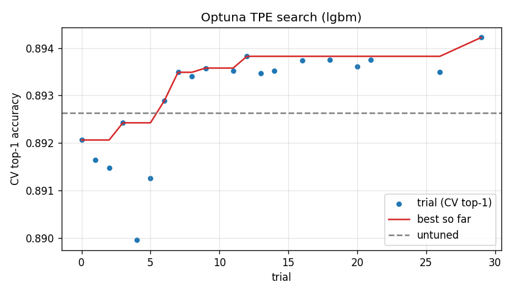{width=49%} 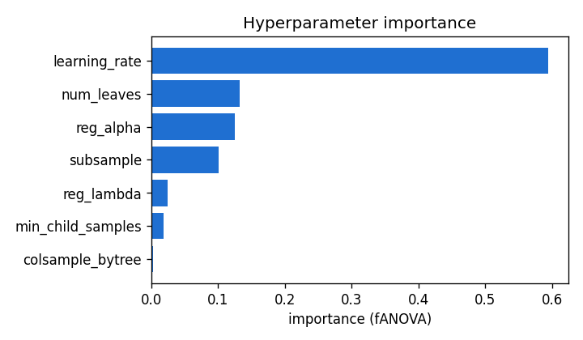{width=49%}

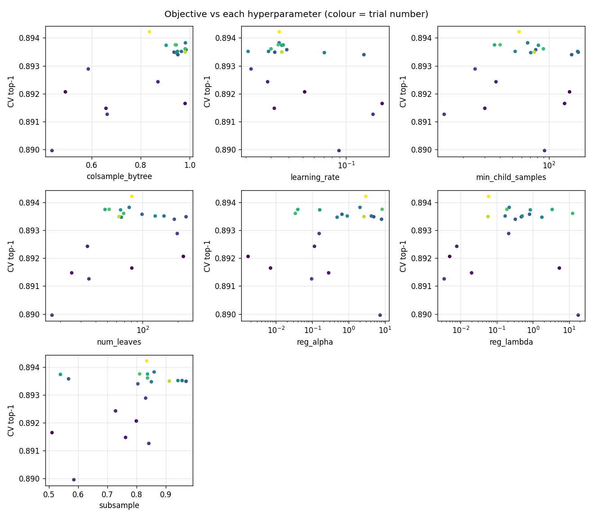{width=90%}

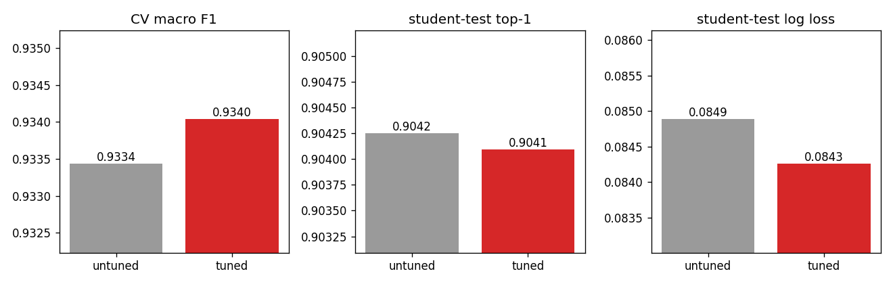{width=80%}

# 5. HMM and Viterbi route reconstruction

Code: `pathsnap/hmm.py`, `pathsnap/inference.py`, `scripts/07_tune_decoder.py`, `scripts/08_eval_hmm.py`, `scripts/09_error_analysis.py`.

1. **Hidden states.** For observation k, each candidate arc j together with the projected position along it. The candidate → arc correspondence is kept exactly; the decoder chooses only among real candidates.
2. **Emissions.** log e_k(j) = w · log max(p_kj / Σ_j p_kj, 10⁻⁴), using the tuned LightGBM probabilities normalised over each observation's candidates. Tuned w = 0.5.
3. **Transitions.** d_route = directed driving distance from (arc i, position) to (arc j, position), found with a bounded Dijkstra; d_gc = straight-line distance between the two GPS points. log a(i→j) = −|d_route − d_gc| / β − u · [j is the reverse of i]. A route much longer than the straight-line move is unlikely. Backward jitter up to 10 m on the same arc counts as zero movement, and turning onto the reverse arc of a two-way street pays the U-turn penalty u. Tuned β = 10 m, u = 8.
4. **Viterbi recurrence.** V_k(j) = max_i [V_{k−1}(i) + log a(i→j)] + log e_k(j), in log space with back-pointers for the backtrack.
5. **Missing candidates and gaps.** Observations without candidates are skipped and the chain continues. If the time gap exceeds 120 s, or no transition is reachable within the search bound (3·d_gc + 150 m, capped by 50 m/s · Δt + 150 m), the chain is cut and decoding restarts from the emissions, so the decoder never invents an impossible connection. For display, consecutive distinct arcs are joined by the shortest network path.
6. **Parameter tuning** used only training data: 30 training trips decoded with out-of-fold probabilities (each scored by a model that never saw it), with a grid over β × w and then u × gap. On those trips: classifier only 0.9065 → default HMM 0.9164 → tuned HMM 0.9238.

**A bug we found and fixed.** In early runs the HMM reduced accuracy on one trip: the decoder locked onto the wrong direction of a two-way street, because small backward moves fitted inside the jitter tolerance and there was no transition to the reverse arc mid-street. Adding the penalised mid-arc U-turn fixed it.

## 5.1 Classifier-only vs classifier + HMM (student test)

| | Pointwise accuracy | Route continuity | Route precision | Route recall | Route F1 |
|---|---|---|---|---|---|
| Classifier only (tuned LightGBM, top-1) | 0.9041 | 0.9348 | | | 0.9018 |
| **Classifier + HMM** | **0.9238** | **0.9886** | 0.9109 | 0.9923 | **0.9483** |

| Trip | Observations | Classifier | HMM | Continuity (classifier → HMM) | Route F1 | Viterbi segments |
|---|---|---|---|---|---|---|
| 00000000 | 2,503 | 0.9541 | 0.9696 | 0.872 → 0.978 | 0.942 | 3 |
| 00000007 | 1,354 | 0.9845 | 0.9742 | 1.000 → 1.000 | 0.980 | 1 |
| 00000009 | 1,049 | 0.8913 | 0.9199 | 0.945 → 0.982 | 0.925 | 1 |
| 00000040 | 2,995 | 0.9339 | 0.9419 | 0.979 → 0.994 | 0.978 | 2 |
| 00000052 | 262 | 0.9771 | 1.0000 | 0.951 → 1.000 | 0.989 | 1 |
| 00000056 | 3,958 | 0.9288 | 0.9532 | 0.873 → 0.993 | 0.966 | 3 |
| 00000065 | 768 | 0.8776 | 0.8880 | 0.943 → 0.986 | 0.871 | 4 |
| 00000076 | 1,486 | 0.9293 | 0.9697 | 0.906 → 0.985 | 0.932 | 1 |
| 00000077 | 3,911 | 0.7880 | 0.8141 | 0.989 → 0.995 | 0.913 | 1 |
| 00000091 | 874 | 0.9165 | 0.9462 | 0.890 → 0.973 | 0.987 | 1 |

**Did the HMM help? Yes.** It improved 9 of 10 trips, raised pointwise accuracy by 2.0 points, cut disconnected jumps from 6.5% to 1.1%, and raised route F1 from 0.902 to 0.948. It was worse on trip 00000007 (0.9845 → 0.9742): the classifier was already near-perfect there, and smoothing moved some points at arc boundaries onto the neighbouring arc. Decoding takes about 1.2 s per trip end-to-end.

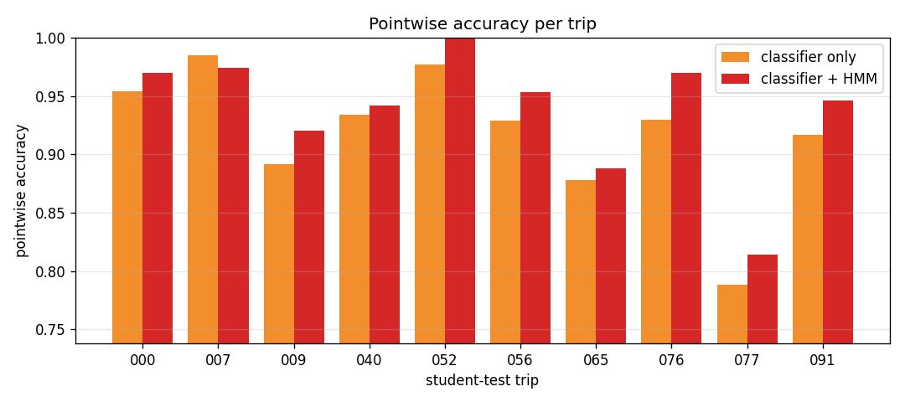{width=49%} 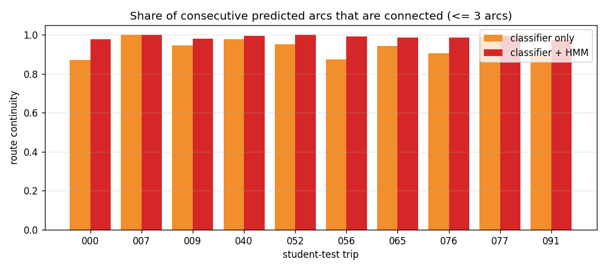{width=49%}

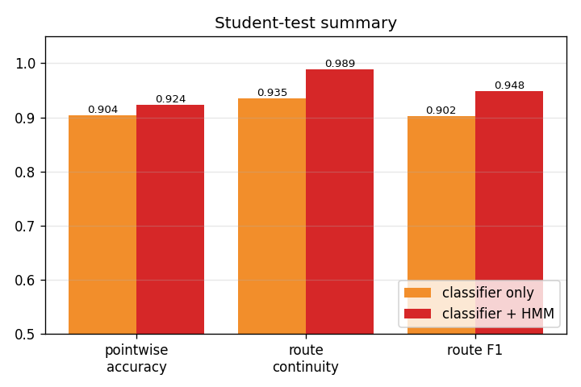{width=60%}

## 5.2 Remaining errors

`results/hmm/error_breakdown.csv` (student test, 19,133 labelled observations):

| | Errors | Wrong direction (reverse arc) | Adjacent arc | Other |
|---|---|---|---|---|
| Classifier only | 1,835 | 841 | 681 | 313 |
| Classifier + HMM | 1,458 | 770 | 537 | 151 |

The HMM halves the "other" errors (a wrong side street or parallel road: 313 → 151), because those break connectivity. Most **wrong-direction** errors remain:

* **Trip 00000077** (lowest accuracy, 0.814): 490 of its 560 wrong-direction errors occur while the vehicle is **stationary**. With no movement there is no heading, so both directions of the street are equally plausible.
* **Trips 00000009, 00000056 and 00000065:** where the vehicle is moving, the GPS heading is about 9° from our predicted arc but about 171° from the reference arc. The vehicle visibly moves in the direction we predict, which points to the reference route's direction being inconsistent with the GPS on those stretches: a limitation of the reference labels rather than of the matcher.

# 6. Geographical visualisation

Map code: `pathsnap/viz.py` (`trip_map`), used by `scripts/03_eda_maps.py` (EDA maps) and `scripts/08_eval_hmm.py` (prediction maps, `figures/maps/student_test_<trip>.html`). Every Folium map has layers for the GPS observations (blue), the road network near the track (grey), the reference route (green), the classifier-only arcs (orange, dashed) and the HMM route (red), plus a legend, a layer control, start and end markers, and bounds fitted to the track. A static rendering of the same layers for trip 00000076:

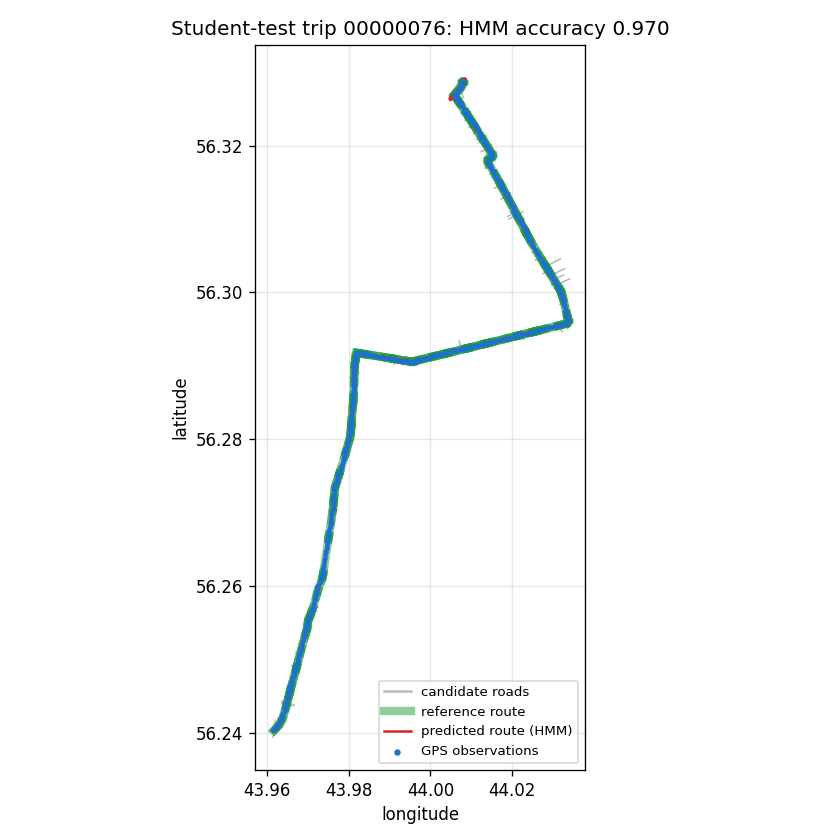{width=70%}

# 7. API, UI and deployment

* **Laptop 1 (backend):** `uvicorn api.main:app --host 0.0.0.0 --port 8000`. On startup it loads `artifacts/model.joblib` and `artifacts/metadata.json` (feature list, candidate settings, tuned HMM parameters). `GET /trips` lists the evaluation trips. `POST /predict {trip_id}` loads the trip **without** its route, runs the full pipeline (candidates, 23 features, LightGBM, HMM), and only then reads the route **server-side** to compute accuracy, continuity and route precision, recall and F1. It returns GPS points, the predicted route, matched points, candidate roads, the metrics and timings; the reference route is never sent. Unknown or malformed trip IDs return 404, which also blocks path traversal. Every request is logged to the console and to `logs/api.log`.
* **Laptop 2 (UI):** `python ui/serve.py --api http://<laptop-1-ip>:8000` serves a static page with Leaflet bundled locally. It lists the trips, sends only the selected trip ID, and draws the result with a layer control and legend. Only map tiles need internet.
* **Networking:** both laptops on the same hotspot; port 8000 allowed through the Windows firewall on Laptop 1.

Two-laptop rehearsal on 18 November 2026: the UI on Laptop 2, connected to the API on Laptop 1 (`192.168.137.90:8000`):

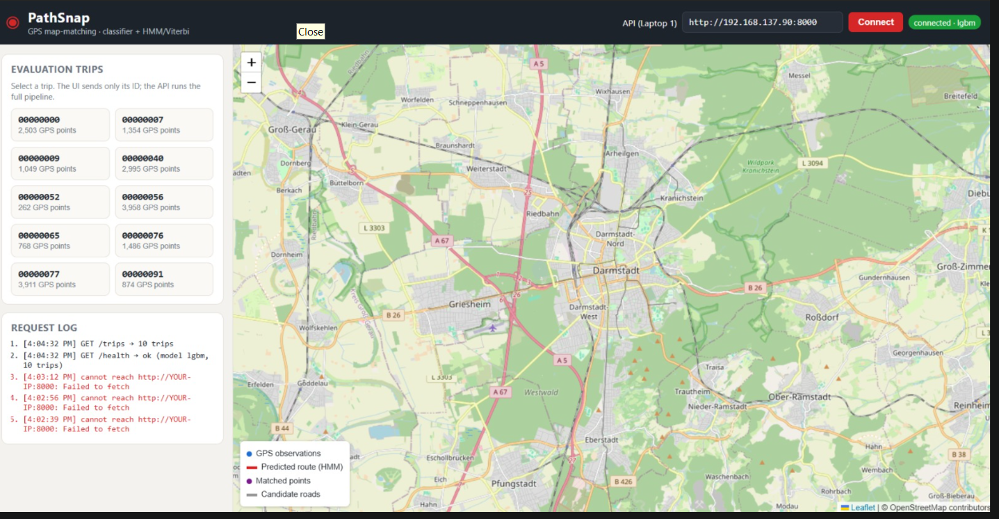{width=95%}

API log on Laptop 1: requests arrive from Laptop 2 (`192.168.137.1`); `POST /predict` for trip 00000076 returns HMM accuracy 0.9697 in 1.2 s:

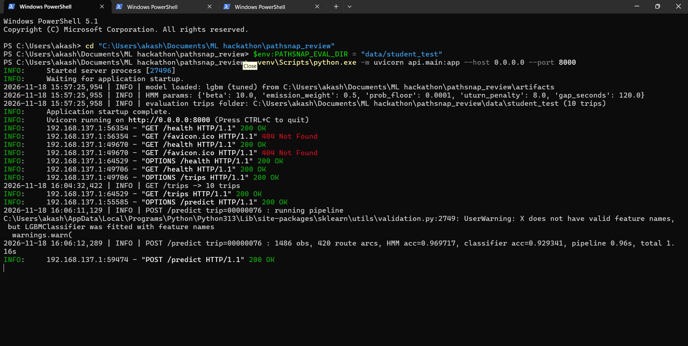{width=95%}

**Data-leakage safeguards.** Prediction uses only `load_trip(..., with_route=False)`, and the predictor refuses a trip with a route attached. Features use only the GPS track and road network. Model selection, Bayesian search and decoder tuning used the training trips (group-aware CV); the student-test trips were used only for development comparison; the evaluator trips are read only by the API. No predictions are hard-coded.

# 8. Limitations and conclusions

* A LightGBM candidate classifier with heading and context features raises top-1 accuracy from 54.5% (nearest road) to 90.4%. The HMM adds road connectivity and raises it to **92.4%**, with 98.9% route continuity and route F1 0.948.
* Most of the gain comes from feature engineering: all eight models land between 87.5% and 90.4%, and removing the heading features alone costs 31 points.
* The main remaining error is direction ambiguity on two-way streets when the vehicle is stopped, plus reference routes whose direction disagrees with the GPS.
* Labels come from our alignment of the reference route, so accuracy inherits any error in it; observations far from the route are excluded rather than guessed.
* The tuned U-turn penalty (8) and gap threshold (120 s) sit at the edge of the grid searched; a wider grid might help slightly.
